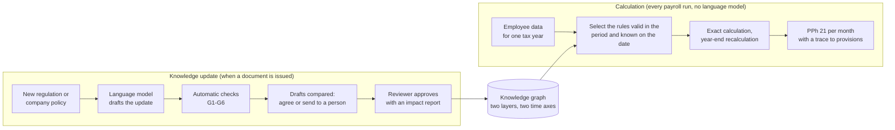
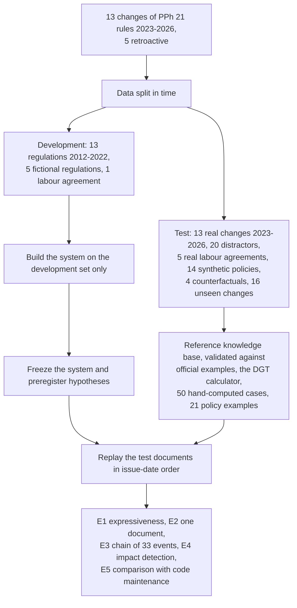

# Adaptive Knowledge-Based System for PPh 21

An adaptive knowledge-based system that calculates Indonesian income tax article 21 (PPh 21) for permanent employees
and keeps itself up to date when regulations and company policies change. The tax rules live in a knowledge graph,
not in program code. A deterministic engine computes the tax with a trace to the legal provisions, and a large language
model reads new documents and drafts updates to the knowledge base, which a reviewer approves or rejects.

This folder is the clean, final version of the system described in the paper *An Adaptive Knowledge-Based System for
PPh 21 Calculation with LLM-Assisted Knowledge Acquisition from Regulations and Company Policies* (Obi Kastanya and
Mahathir Muhammad, Institut Teknologi Sepuluh Nopember).

- [What the system does](#what-the-system-does)
- [Setup](#setup)
- [How the system works](#how-the-system-works)
- [How the research was done](#how-the-research-was-done)
- [Worked example](#worked-example)
- [Project layout](#project-layout)
- [Important notes](#important-notes)

---

## What the system does

Indonesian employers withhold PPh 21 every month. The rules changed 13 times between 2023 and 2026, five of them
retroactively, and each company adds its own payroll policy on top. Most payroll calculators embed these rules in code,
so every change means a new software release. This system separates the knowledge from the program:

| | Without this system | With this system |
|---|---|---|
| A new regulation is issued | A developer changes and releases the calculator | The model drafts an update from the document; a reviewer approves it |
| A company changes its payroll policy | Custom code per company | The policy is a second layer of rules, checked against the regulations |
| "What did we owe in January?" after a retroactive rule | Recalculated by hand | Asked of the knowledge base at two knowledge dates |
| "Why is the tax this amount?" | Read the code | Every value traces to its rule and the quoted article |

Two flows meet in the knowledge base:



The language model never changes the knowledge base by itself and is never used to calculate tax.

---

## Setup

Requirements: Python 3.12. Everything else is installed with pip.

```bash
cd system_final
python -m venv .venv
source .venv/bin/activate          # Windows PowerShell: .venv\Scripts\Activate.ps1   cmd: .venv\Scripts\activate.bat
python -m pip install -r requirements.txt
python cli.py check                # packages, keys (presence only), the knowledge base and its SHACL validation
python -m pytest                   # 67 tests, about two minutes
```

API keys are needed only to read new documents with the language model:

```bash
cp .env.example .env               # Windows: copy .env.example .env
```

Fill in `CLAUDE_API_KEY` (drafting updates) and, optionally, `OPENAI_API_KEY` (mapping documents before Claude reads
them, and the assistant of the app). A variable
set in the shell takes precedence over `.env`. The calculator, the knowledge-base viewer, the sample policies, and the
tests work without any key.

Optional components:

| Component | What it adds | How |
|---|---|---|
| Docling | Upload of PDF files (layout, OCR of scanned pages, table structure); text files work without it | `pip install docling==2.144.0` |
| Tesseract with Indonesian (`ind`) | Better OCR of scanned Indonesian documents | Install Tesseract; it is found on the PATH or in `C:\Program Files\Tesseract-OCR` |
| GraphDB 11.5 | Browse and query the knowledge graph with SPARQL in a workbench | Run GraphDB, create a repository `pph21` (ruleset `empty`, context index on), then run `python cli.py graphdb`, which loads the ontology and the starting knowledge base. Validation does not need GraphDB: the system validates with pySHACL |

### Run it

```bash
streamlit run app/main.py                                                   # the application, http://localhost:8501
python cli.py calculate --year 2024 --salary 15000000 --ptkp K/1 --thr 15000000 --thr-month 3
python cli.py calculate --year 2024 --salary 15000000 --ptkp K/1 --trace 1:pph21_due
python cli.py calculate --year 2024 --salary 15000000 --ptkp K/1 --policy SP09
python cli.py acquire examples/documents/SP09.txt --title "Sample company regulation" --issued 2023-08-01 --company
```

The application has four pages:

- **Home**: what the system does, the state of the knowledge base, and where to start.
- **PPh 21 calculator**: one employee, one table per month; the input fields come from the rules in force; every
  result card is built from the engine trace; the final period recalculates the year.
- **Knowledge base viewer**: rules, numbers and tables by topic, values over time, version history, a comparison of
  two knowledge dates, and a technical tab (knowledge graph, one record as RDF, ontology and SHACL, SPARQL).
- **Knowledge base management**: upload a document and let the model propose an update; review it with the automatic
  checks, before-and-after results, and the company policies it affects; approve, edit, ask the model to repair it,
  or reject it. Sample company policies can be sent to review without the model.

**The demo company and the starting date.** The app starts from the knowledge base as known on 29 February 2024 (the
updates of `seed.trig` recorded on or before that date, the last being the BPJS letter on the JP wage cap 2024; set
`PPH21_KB_KNOWN_UNTIL` to change it, or leave it empty for the full seed). The calculator's company is PT TKG Taekwang
Indonesia, a footwear factory in Kabupaten Subang (KLU 15201, eligible for the DTP incentive; JKK risk group assumed
medium, group III of the annex of PP 44/2015), with five illustrative employees as scenarios. Under *New documents →
No file at hand? Use a sample document* the upload box offers, oldest first, the regulations issued after that date
(PMK 10/2025, PP 7/2025, the BPJS letter on the JP wage cap 2025, PER-11/PJ/2025, PP 36/2025, PMK 72/2025, PMK
105/2025, the BPJS letter on the JP wage cap 2026) and two that do not change the PPh 21 of permanent employees (PP
50/2025, PP 9/2026). The company's labour agreement (PKB 2024-2026, signed 15 March 2024) is offered there only when
the research data set lies next to this folder, since its text is copyrighted; its reference formalisation from the
research is a sample company policy. The sidebar shows the
company as the *Case study* (read from `data/presets/case_company.json`); hovering it shows a short profile and the regulations
that concern the company, each marked *Locked* (in the starting knowledge base), *Added* (approved in the app), or *Not
added yet*.

The application keeps its work in `workspace/` (approved updates, uploaded documents, model calls and costs). To return
to the starting knowledge base, use the reset icon at the top of the sidebar, or **Start over** at the bottom of
*Knowledge base management → Version history*. Both keep the log of model calls, so the spending limits still hold;
deleting `workspace/` by hand removes that log too.

A document read by the model ends in one of these states:

| State | Meaning |
|---|---|
| Waiting for the AI | the document is uploaded; the model has not read it yet |
| Ready for review | the drafts agree; a person reviews the proposed update |
| AI not sure | the drafts disagree or none passed the checks; a person formalises the document by hand |
| Not relevant | the document does not change the PPh 21 calculation |
| AI budget used up | the spending limit stopped the run |
| Approved / Rejected | the reviewer's decision; only an approved update enters the knowledge base |

---

## How the system works

### The knowledge base

Every piece of tax knowledge is an immutable **record** of one of five kinds:

| Kind | Example |
|---|---|
| rule | `pph21_running = TER rate x monthly gross income`, valid from January 2024 |
| parameter | the job-expense cap of Rp6,000,000 per year |
| table | the PTKP amounts, the Article 17 brackets, the monthly TER rates |
| constraint | a minimum entitlement checked on the results |
| fact | a named value such as `gross_income` (money, period scope) |

Records are never edited. An **update** adds records: a new element, a new version of an existing one, or a removal.
Each record carries two time axes:

- **legal validity** (`valid_from` to `valid_until`): the tax periods the provision covers, including periods before the
  document was issued when the rule is retroactive;
- **knowledge date** (`recorded_on`, the issue date of the document): when the system could know the rule.

So the knowledge base answers *"what applies to period t, as known on date ω?"*. A retroactive rule makes the answer
for a past month depend on ω, and the difference between the two answers is the correction the employer owes.

There are **two layers**: regulations (mandatory, default, or optional provisions) and company policies (one set of
rules per policy, active only for employees whose employer has that policy). Rules are written in a small,
safe expression language with exact arithmetic (fractions, no floating point) and explicit rounding.

The knowledge base is an RDF **knowledge graph** (ontology in `spec/ontology.ttl`, using ELI, OWL-Time, and PROV-O),
validated with SHACL (`spec/shapes.ttl`, 14 node shapes and 12 SPARQL constraints), with one named graph per update.
It is loaded in memory with rdflib; GraphDB is optional.

### The calculation engine (`pph21kbs/engine.py`)

For one employee and one tax year, the engine asks for each output value (`pph21_due`, `take_home_pay`, ...) per
month and evaluates whatever it reads on demand, with memoisation, which follows the dependency graph in topological
order. For each value it:

1. selects the rules that produce it, are valid in the period, were known on ω, belong to the employee's company
   policy (company layer), and whose condition holds;
2. resolves conflicts: **lex superior** (mandatory regulation > company rule > adopted optional provision > default),
   then **lex specialis** (a rule that explicitly overrides another wins), then **lex posterior** (the later rule);
   a company rule that loses to a mandatory rule with a different value is reported as a conflict;
3. evaluates the winning rule exactly; gross-up rules compute the least fixed point by iteration;
4. records a trace: the rule, its layer, the values it read, the rules it beat and why, and the quoted provision.

In the final period the year is recalculated with the Article 17 rates, and the difference is withheld or refunded.

### The acquisition pipeline (`pph21kbs/pipeline.py`)

| Step | What happens |
|---|---|
| 1. Text | The document is split into opening, articles, closing, and annexes; extracted annex tables are shown as table descriptions. In the app, a low-cost OpenAI model (`gpt-5.4-mini`, `pph21kbs/digest.py`) first maps every part: parts about PPh 21 are sent word for word, general parts as one-line summaries marked as not quotable, and unrelated parts are left out (budget 40,000 tokens). Without the map (no OpenAI key, `PPH21_DIGEST=off`, `cli.py`, the research) the segments with the most PPh 21 terms are chosen within a 14,000-token budget |
| 2. Relevance | One model call decides whether the document changes the calculation, with verbatim quotes |
| 3. Context | The model sees the vocabulary of the knowledge base, the 29 registered functions, up to 220 related records, and the case-data inputs that exist |
| 4. Drafts | m independent drafts (default 3) of the update as structured JSON, each element with quotes from the document |
| 5. Checks | Gates G1, G6, G2, G3, G4, G5, in that order (below); a draft that fails gets one repair round with the gate messages |
| 6. Agreement | Drafts that pass are run on generated cases; the largest group of drafts that behave the same wins; a tie, or no passing draft, sends the document to a person ("AI not sure") |
| 7. Review | A person sees the proposal, the checks, before-and-after results, and the affected company policies |

| Gate | Checks |
|---|---|
| G1 | The update matches the JSON schema, applies to the knowledge base, and the result satisfies the SHACL shapes |
| G6 | Every case-data input the update reads exists in the payroll data (an invented attribute name would never fire) |
| G2 | Every quote occurs verbatim in the document; every number of 100 or more, every rate, and every date appears in a quote of its element (numbers derived from quoted ones are accepted); `recorded_on` equals the issue date |
| G3 | Static consistency: no dependency cycle, no dangling reference, no unknown name |
| G4 | On generated cases: no new engine error, and no change as known one day before the issue date; for a company policy only engine errors count, since a policy changes results by design |
| G5 | Hard checks: every element has an effect on some case, and a regulation changes at least one result. Warnings: dates and subjects stated by the document that do not show in the cases |

Before an update is approved, the **impact detector** (`pipeline.detect`) lists the company policies whose rules
read, produce, or compete with a value the update changes, so the reviewer knows which policies to look at. The
detector is written in Python for speed; the same logic in SPARQL is in `spec/queries/` (`pipeline.detect_sparql`),
and a test checks that both give the same answer.

---

## How the research was done

The research asked whether such a system can stay correct when the rules change, and how far a language model can be
trusted to draft the changes. The evaluation design was preregistered before the first test event was run.



- **Test cases**: 2,398 employee-year cases (300 per tax year sampled from provincial wage data of Statistics
  Indonesia, full pairwise combinations of the case attributes, and cases around every Article 17 and TER bracket
  boundary), plus 120-180 cases per company policy.
- **Replay protocol**: each document is applied either to the reference knowledge base before it (isolated mode) or to
  the knowledge base the system itself built so far (chained mode), which separates inherited errors, new errors, and
  errors triggered by the chain.
- **Main results** (the frozen pipeline, Claude Opus 5.5):
  - the representation expressed all 16 unseen changes without changing the engine, once the rounding convention of
    their examples was aligned (8 of 16 without that alignment);
  - drafted updates were correct for 8 of 18 real documents, silently wrong for 3, and sent to a person for 7;
    all five single-element updates succeeded, and none of the nine documents that needed 11 or more elements did,
    including the five labour agreements;
  - the impact detector found 91% of the affected policies (precision 0.71);
  - two open-source calculators added the TER method 26 and 915 days after the regulation was issued; the model calls
    that drafted the same update took about 12.5 minutes of model time (review time not measured).

**Version of this folder.** `system_final` contains the improved acquisition pipeline (version 2): the case-data
inputs are shown to the model and checked by gate G6, G5 reports dates and elements without effect as warnings, the
draft prompt has modelling guidance and a checklist for company policies, and the drafts are compared by the facts
their conflicts concern instead of rule names. On the development set (seven synthetic company policies) these
changes reduced silent errors from 5 to 1. **Version 2 has not yet been evaluated on the test documents with the
model API**, so the numbers above describe version 1. The app goes further than the research configuration: Claude
Sonnet 5.5 drafts the updates (the research used Claude Opus 5.5; `PPH21_MAIN_MODEL` selects the model), and documents
are mapped by the low-cost model before Claude reads them (step 1). Neither change has been evaluated on the test
documents. The calculation engine and the knowledge base behave as in the research: on
all 2,398 test cases at three knowledge dates (7,194 evaluations), this folder gives exactly the same values,
conflicts, and errors as the research system.

---

## Worked example

PP 58/2023 (issued 27 December 2023) replaced the annualised withholding method with monthly effective rates (TER)
from January 2024. Its update has seven records: two facts (`ter_category`, `ter_rate`), two tables (PTKP status to
TER category, and the monthly TER rates of the annex), and three rules. The rule that computes the monthly tax is:

```
rule      REG.TER.RUNNING      produces pph21_running   valid from 2024-01-01   recorded on 2023-12-27
condition not is_final_period
value     round(ter_rate * gross_income, 1, param('pph_round_mode'))
source    PP 58/2023, elucidation of Article 2(1)
```

It needs no `overrides`. The old monthly rule, `REG.P16.RUNNING` (PER-16/PJ/2016), gets a new version from PMK 168/2023
(recorded 29 December 2023) that closes it at 31 December 2023. Before that update is recorded, the TER rule already
wins from January 2024 by lex posterior, because its validity starts later.

Employee A earns Rp15,000,000 a month, has PTKP status K/1, and receives a THR of Rp15,000,000 in March 2024
(the same case is in `examples/cases/employee_a_2024.json`):

```bash
python cli.py calculate --case examples/cases/employee_a_2024.json --trace 1:pph21_due
```

Abridged trace of January:

```
pph21_due = 933660                  [REG.PPH.DUE.RUNNING]
  gross_income = 15561000           [REG.GROSS]          salary + employer premiums (JKK 36,000, JKM 45,000, JKN 480,000)
  pph21_running = 933660            [REG.TER.RUNNING]    PP-58-2023 Penjelasan Pasal 2 ayat (1)
    ter_category = B                [REG.TER.CATEGORY]   K/1 -> B
    ter_rate = 3/50                 [REG.TER.RATE]       6%
```

January is 6% x Rp15,561,000 = **Rp933,660**. In March the THR raises gross income to Rp30,561,000 and the rate
table gives 12%: **Rp3,667,320**. December recalculates the year with Article 17: **Rp186,480**. Asked with
`--omega 2023-12-01`, before PP 58/2023 was recorded, the same January gives **Rp912,300** under the old method.
Provisions are cited in the wording of the source (*Pasal* = article, *ayat* = paragraph, *Penjelasan* = elucidation).

---

## Project layout

```
system_final/
├── README.md             this file
├── cli.py                command line: calculate, acquire, check, graphdb
├── requirements.txt      pinned dependencies
├── .env.example          API keys and optional settings
├── pytest.ini
│
├── pph21kbs/             the library; read in this order
│   ├── expr.py           1. expression language: parser, function catalogue, exact numbers and rounding
│   ├── kb.py             2. records, knowledge base, knowledge-date views, updates (Delta)
│   ├── graph.py          3. RDF knowledge graph, SHACL validation, optional GraphDB
│   ├── engine.py         4. inference engine and trace
│   ├── consistency.py    5. static checks (gate G3 and the knowledge-base checker)
│   ├── documents.py      6. document registry, texts, quotes, PDF extraction, segmentation, text selection
│   ├── digest.py         6b. map of a document by a low-cost model: what is sent word for word, summarised, left out
│   ├── draft.py          7. what the model sees and writes: context, prompts, model clients and costs, conversion
│   ├── gates.py          8. gates G1-G6 and the generated cases they run on
│   ├── pipeline.py       9. acquisition pipeline, agreement of drafts, impact on company policies
│   └── config.py         file locations, model, spending limits, keys
│
├── app/                  Streamlit application
│   ├── main.py           entry point, navigation, home page
│   ├── state.py          application state, labels, formatting, engine call
│   ├── common.py         glossary of terms and shared interface elements
│   ├── calculator.py     PPh 21 calculator, employee data, input fields, result explanations
│   ├── knowledge_base.py knowledge-base viewer and its technical tab
│   ├── manage.py         knowledge-base management: documents, review, versions, policies
│   └── workflow.py       the model in the app: reading documents, repairs, drafts, assistant
│
├── spec/                 ontology, SHACL shapes, SPARQL queries of the impact detector, JSON schemas
├── data/
│   ├── kb/seed.trig      the starting knowledge base: 37 updates (2009-2026), 282 records
│   ├── kb/documents.csv  the documents its records cite
│   ├── policies/         company policies as ready-made updates: three synthetic ones and the Taekwang PKB
│   └── presets/          input definitions, the company and its pay components, calculator scenarios, and the
│                         case study shown in the sidebar (case_company.json)
├── examples/
│   ├── documents/        texts of the sample policies and of later regulations, with their list (samples.json)
│   ├── documents_original/  the published PDFs of those regulations, to try the upload with a real file (PDF
│   │                     reading needs Docling); named <text name>__<gov|comp>__<issue date yyyymmdd>, which
│   │                     gives the kind and the issue date to enter in the upload form
│   └── cases/            a calculator case (employee A, 2024) for `cli.py calculate --case`
└── tests/                engine, knowledge graph and checks, pipeline with a mock model, impact detector
```

---

## Important notes

- **Not tax advice.** The system supports payroll staff; the employer remains responsible for every withholding.
- **Scope.** PPh 21 of permanent employees (*pegawai tetap*), with the social security contributions and benefits that
  enter gross income or deductions, for the rules recorded from 2009 to 2026. Other taxpayer groups are out of scope.
- **The model only drafts.** Nothing enters the knowledge base without a person's approval. Documents with many
  provisions and company labour agreements are the hard cases; expect the model to be unsure, and review them fully.
- **Validation.** The reference knowledge base and the 16 unseen changes were checked by independent AI reviewers
  against the source texts and four external references, not yet by a human tax practitioner.
- **Data.** The starting knowledge base cites public regulations; the quotes are from those texts. Real company labour
  agreements of the research are not included (their texts are copyrighted); three sample policies are synthetic, and
  the Taekwang PKB policy is the research's formalisation of that agreement, with short quotes of its articles. The
  wages of the calculator scenarios are illustrative.
  No personal data is included.
- **Costs.** Reading one document with three drafts costs about USD 0.1-0.5 with Claude Sonnet 5.5, plus about USD
  0.01-0.6 for the map, depending on the length (October 2026 prices; with Claude Opus 5.5 the drafts cost about USD
  0.1-0.9). Every call and its cost is logged in `workspace/calls/`; set `PPH21_BUDGET_ANTHROPIC_USD` and
  `PPH21_BUDGET_OPENAI_USD` to cap the totals.
- **Reproducing the paper.** The research code, data, and experiment logs are in the parent repository (`system/`,
  `dataset/`, `experiments/`); the paper's numbers come from that code at the tag `penelitian-selesai`.
